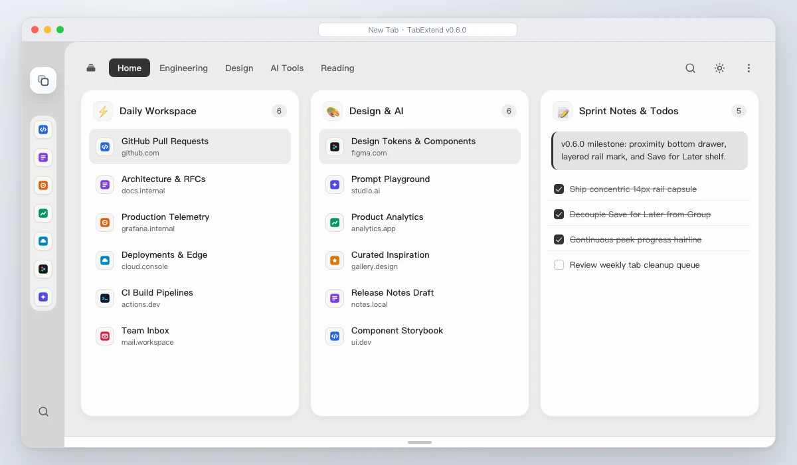
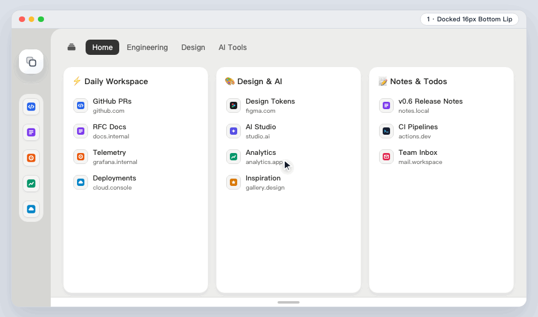
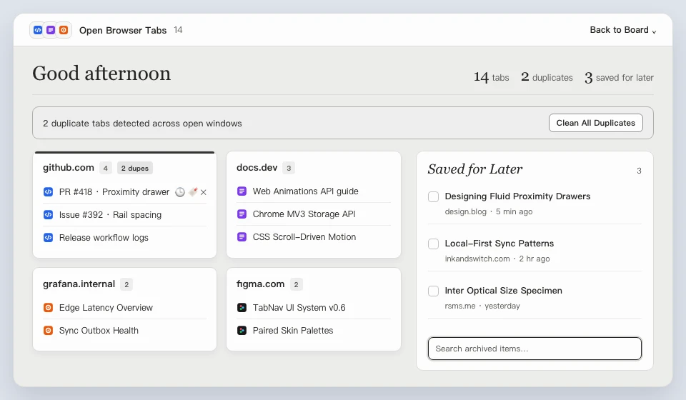
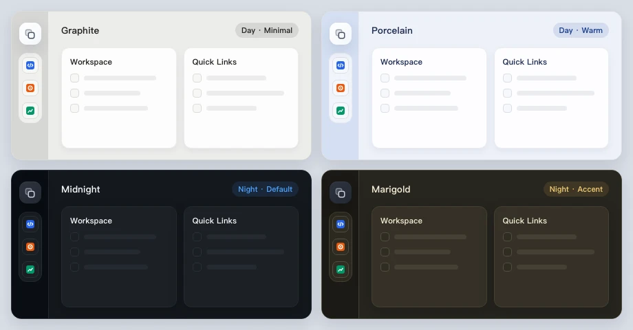

<div align="center">
  
  <h1>TabExtend</h1>
  <p><strong>本地优先的 Chrome 新标签页工作台</strong><br/>用工作区、分类分组、内置笔记待办与底部渐进抽屉，让每一次打开新标签页都安静顺手。</p>

  <p>
    <a href="https://github.com/blingbling2333/TabExtend-releases/releases/latest">
      
    </a>
    
    
    <a href="INSTALL_FOR_AI.md">
      
    </a>
    <a href="https://github.com/blingbling2333/TabExtend-releases/releases">
      
    </a>
  </p>

  <p>
    <a href="https://github.com/blingbling2333/TabExtend-releases/releases/latest"><strong>⬇️ 下载最新版本</strong></a>
    &nbsp;·&nbsp;
    <a href="#-一句话让-ai-帮你安装">🤖 让 AI 帮你安装</a>
    &nbsp;·&nbsp;
    <a href="#-顺滑的底部标签抽屉">🎬 动图演示</a>
    &nbsp;·&nbsp;
    <a href="#安装">📦 手动安装</a>
    &nbsp;·&nbsp;
    <a href="https://github.com/blingbling2333/TabExtend-releases/releases">📋 更新记录</a>
  </p>
</div>

<br />

<div align="center">
  <picture>
    <source media="(prefers-color-scheme: dark)" srcset="assets/hero-dark.webp" />
    <source media="(prefers-color-scheme: light)" srcset="assets/hero-light.webp" />
    
  </picture>
  <sub>▲ 自动随 GitHub 深浅色外观切换 · 左侧双层标签标识与常驻站点胶囊 + 分组卡片（链接 / 笔记 / 待办）</sub>
</div>

---

## 🤖 一句话让 AI 帮你安装

本仓库内置了面向 AI Coding Agent 的机器可读入口（[`llms.txt`](llms.txt) + [`INSTALL_FOR_AI.md`](INSTALL_FOR_AI.md)）与官方 SHA-256 自动校验安装脚本。

直接把下面这句话发给 **Claude Code / Codex / Cursor / Antigravity / OpenClaw** 等任意 AI Agent：

```text
帮我安装（或更新）这个 Chrome 扩展：https://github.com/blingbling2333/TabExtend-releases
```

AI 会自动完成：拉取最新正式版 `tabnav-v*.zip` → 严格校验 SHA-256 → 解压到永久目录（更新时保持原目录不变、自动清理旧文件并完整保留本地数据）→ 告诉你最后一步在 `chrome://extensions` 点一下「加载已解压的扩展程序」或「重新加载」。

### 或者直接执行官方一行安装脚本

**macOS / Linux：**

```bash
curl -fsSL https://raw.githubusercontent.com/blingbling2333/TabExtend-releases/main/scripts/install.sh | bash
```

**Windows (PowerShell)：**

```powershell
irm https://raw.githubusercontent.com/blingbling2333/TabExtend-releases/main/scripts/install.ps1 | iex
```

<details>
<summary>高级选项与 AI Agent 结构化输出（<code>--json</code> / 指定目录 / 指定版本）</summary>

```bash
# 输出机器可读 JSON（推荐给 AI Agent）
curl -fsSL https://raw.githubusercontent.com/blingbling2333/TabExtend-releases/main/scripts/install.sh | bash -s -- --json

# 指定永久安装目录或特定版本
curl -fsSL https://raw.githubusercontent.com/blingbling2333/TabExtend-releases/main/scripts/install.sh | bash -s -- --dir ~/Applications/TabExtend --version 0.6.0
```

- 默认永久目录：macOS `~/Applications/TabExtend` · Linux `~/.local/share/tabextend` · Windows `%LOCALAPPDATA%\TabExtend`
- 完整 Agent 操作手册见 [`INSTALL_FOR_AI.md`](INSTALL_FOR_AI.md) 与 [`llms.txt`](llms.txt)
- 出于 Chrome 安全策略，脚本绝不会篡改浏览器配置强行注入扩展；解压校验完成后由你在 `chrome://extensions` 确认加载即可。

</details>

---

## 🎬 顺滑的底部标签抽屉

在看板底部保留一条克制的 `16px` 呼吸边槽：鼠标越靠近底边，**Open Browser Tabs** 抽屉露出的越多，顶部细线进度条从进入触发区起连续跟随；贴底短停即丝滑展开，把手自然升至顶部并随时一键回到看板。

<div align="center">
  
</div>

---

## ✨ 核心体验

<table>
  <tr>
    <td width="50%" valign="top">
      
      <br /><br />
      <strong>🗂️ 标签整理器 & Saved for Later 书架</strong><br />
      按域名自动聚类当前打开的浏览器标签，支持一键清理重复标签；独立「稍后阅读」书架与普通分组彻底解耦，随手暂存长文不弄乱常用看板。
    </td>
    <td width="50%" valign="top">
      
      <br /><br />
      <strong>🎨 成对视觉皮肤 & 克制左侧轨道</strong><br />
      提供 Graphite / Porcelain / Midnight / Marigold 四套深浅成对皮肤，搭配同心圆角常驻站点胶囊与双层标签品牌标识，长时间使用依然清爽耐看。
    </td>
  </tr>
</table>

- **四层清晰结构**：`Workspace → Category → Group → Link / Note / Todo`，把常用入口、轻量笔记与待办清单放进同一块新标签页。
- **本地优先、毫秒响应**：数据默认存在本地 IndexedDB，无网络依赖，打开新标签页即刻就绪；支持随时导出备份与回收站恢复。
- **可验证的公开分发**：每次发布都自动运行完整测试与安全校验，并附带 `.zip.sha256` 校验文件。

---

## 安装

如果你更习惯纯手动下载安装（不运行脚本）：

1. 打开 [**最新版本发布页**](https://github.com/blingbling2333/TabExtend-releases/releases/latest)，在 **Assets** 中下载 `tabnav-v版本号.zip`。**不要下载** GitHub 自动生成的 `Source code`。
2. 将 ZIP 解压到一个准备长期保留的目录（例如 `~/Applications/TabExtend`）。
3. 在 Chrome 地址栏打开 `chrome://extensions`，开启右上角的「开发者模式」。
4. 点击「加载已解压的扩展程序」，选择直接包含 `manifest.json` 的目录。
5. 打开新标签页即可使用。Chrome 扩展列表中显示的名称目前为 **TabNav**。

## 更新

- **一键原地更新**：直接重新运行上面的 `install.sh` / `install.ps1`（或让 AI 帮你更新），脚本会自动清理旧程序文件并保留目录路径。
- **手动更新**：
  1. 建议先在扩展中导出一份备份。
  2. 关闭扩展的新标签页，将新版 ZIP 解压并替换到原安装目录（清理旧程序文件，保留原目录路径）。
  3. 打开 `chrome://extensions`，点击 **TabNav** 卡片上的「重新加载」按钮即可。

> **无需先卸载旧扩展**（卸载会清空本地存储数据）。通过本仓库安装的扩展需要手动或通过脚本更新。

## 校验下载

每个版本都附带 `.zip.sha256` 校验文件。

**macOS / Linux：**

```bash
shasum -a 256 -c tabnav-v版本号.zip.sha256
```

**Windows (PowerShell)：**

```powershell
Get-FileHash tabnav-v版本号.zip -Algorithm SHA256
```

将输出的哈希与 `.sha256` 文件中的值比对一致即可确认安装包完整未被篡改。

## 发布节奏与仓库说明

- 正式版本按补丁号每 5 个版本发布一次（如 `0.5.95`、`0.6.0`），发布页汇总该批次全部升级特性、对应提交记录及界面截图/动图。
- 本仓库提供经过自动测试和构建的公开安装包、安装脚本与发布校验工具；源码仓库保持私有。
- 面向 AI 工具的索引与脚本：[`llms.txt`](llms.txt) · [`INSTALL_FOR_AI.md`](INSTALL_FOR_AI.md) · [`scripts/install.sh`](scripts/install.sh) · [`scripts/install.ps1`](scripts/install.ps1)。
- 发现问题或建议欢迎在 [Issues](https://github.com/blingbling2333/TabExtend-releases/issues) 中反馈，请附上扩展版本、Chrome 版本和复现步骤，**切勿上传账号凭据或私人收藏数据**。
